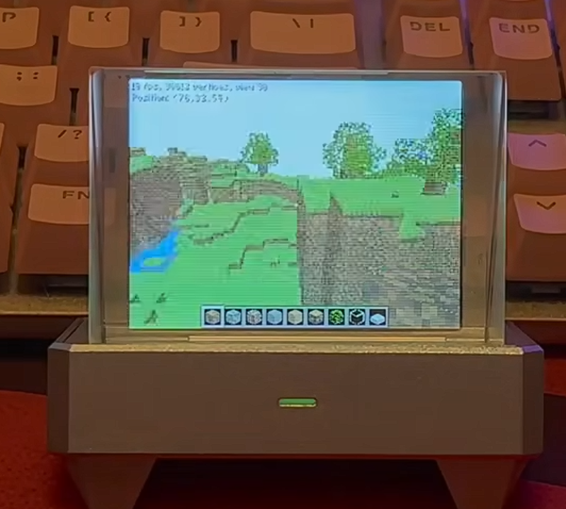

# Minecraft on ESP32-S3 · ClassiCube Port

> 在 Cubic/Holo ESP32-S3 动态模块平台上运行的离线 ClassiCube。
>
> An offline ClassiCube port for the Cubic/Holo ESP32-S3 dynamic-module platform.

[中文](#中文) · [English](#english) · [演示视频 / Demo Video](https://www.bilibili.com/video/BV1bU4X6eErq) · [ClassiCube](https://github.com/ClassiCube/ClassiCube)



> [!NOTE]
> 本项目基于开源项目 ClassiCube 进行移植和优化，不是 Mojang Studios 的官方 Minecraft 客户端，也不包含官方 Minecraft 音乐。

## 中文

### 项目简介

这是一个面向 **Cubic/Holo ESP32-S3 动态模块宿主**的 ClassiCube 移植项目。游戏以应用包的形式运行，与宿主固件共享显示、输入、文件系统、内存、任务和音频接口，而不是生成一份独立烧录的固件。

项目基于 [ClassiCube](https://github.com/ClassiCube/ClassiCube) 开发，并针对 ESP32-S3 的内存规模、双核调度、RGB565 屏幕、手柄输入和软件渲染性能进行了专门适配。当前目标是先提供一个可玩的离线单人版本。

🎬 **实机演示：** [在哔哩哔哩观看视频](https://www.bilibili.com/video/BV1bU4X6eErq)

### 当前功能

| 项目 | 当前实现 |
| --- | --- |
| 游戏模式 | 离线单人模式 |
| 世界 | 自动生成的 160 × 40 × 160 方块世界 |
| 3D 渲染 | 192 × 144 ClassiCube SoftFP 定点软件渲染 |
| 屏幕输出 | 原生 320 × 240 UI，RGB565 DMA 输出 |
| 视距 | 25、30、35 格三档，默认 30 格 |
| 存储 | 游戏状态、选项和地图保存在 SD 卡 |
| 输入 | 通过 Lua 到原生模块的手柄桥接 |
| 音频 | 22050 Hz 单声道音效混音和流式 PCM 背景音乐 |
| 内存 | 游戏堆、主任务栈和场景快照使用 PSRAM |

当前版本暂不支持联网、自动更新、插件和 FreeType 字体。

### 运行要求

- 主要目标设备：[clocteck HoloCubic ESP32-S3](https://github.com/clocteck)
- PSRAM（当前版本为必需）、SD 卡和 320 × 240 RGB565 显示屏
- 支持当前动态模块 ABI 的 HoloCubic 宿主固件

本项目也可以移植到其他 ESP32-S3 设备，但需要根据目标硬件自行实现显示、输入、文件系统、内存、任务和音频等底层接口。

### 安装

构建完成后会生成完整应用包：

```text
dist/classicube-esp32s3-0.1.0.zip
```

将压缩包中的全部内容复制到 SD 卡：

```text
/sd/apps/classicube
```

最终目录至少应包含：

```text
/sd/apps/classicube/app.info
/sd/apps/classicube/main.lua
/sd/apps/classicube/modules/classicube.so
/sd/apps/classicube/texpacks/default.zip
```

### 从源码构建

使用 Windows PowerShell、ESP-IDF 5.5/PlatformIO 工具链以及兼容的 HoloCubic 宿主工程构建：

```powershell
powershell.exe -NoProfile -ExecutionPolicy Bypass `
  -File .\tools\build-s3-module.ps1 `
  -HostRoot "C:\path\to\your\holocubic-host" `
  -Reconfigure
```

`HostRoot` 必须包含 `src/dynmod/module_abi.h`。后续构建可省略 `-Reconfigure`。产物为 `package/modules/classicube.so` 和 `dist/classicube-esp32s3-0.1.0.zip`。

### 默认按键

| 按键 | 功能 |
| --- | --- |
| 左摇杆 / 方向键 | 移动 |
| 右摇杆 | 转动视角 |
| A | 跳跃；菜单确认 |
| B / SELECT | 返回或关闭 |
| X | 打开物品栏 |
| Y | 选取准星指向的方块 |
| RT / L | 删除方块 |
| LT / R | 放置方块 |
| 左摇杆按下 / 右摇杆按下 | 上一个 / 下一个快捷栏槽位 |
| START | 暂停；进入菜单后使用方向键和 A 操作 |
| HOME | 停止模块并返回宿主 |

### 与上游 ClassiCube 的区别

本项目不是简单增加一个 ESP32-S3 平台入口，而是以 ClassiCube 提供的通用 SoftFP 软件渲染器为基础，针对 ESP32-S3 的内部 RAM、PSRAM、双核和 SPI LCD 带宽重新设计了地形热路径。以下对比基于仓库固定的上游提交 `bb706fd05ad6c338e68a17b4f2db45ef3a21663a`。

| 项目 | 上游 ClassiCube | 本项目 ESP32-S3 路径 |
| --- | --- | --- |
| 目标平台 | 通用多平台客户端和通用 SoftFP 后端 | 固定 320 × 240 HoloCubic 硬件与动态模块 ABI |
| 3D 与 UI | 通常共用窗口分辨率和完整帧缓冲 | 192 × 144 3D + 320 × 240 HUD/菜单，输出时融合 |
| 深度缓冲 | 每像素 32 位整数 | 非线性 reciprocal-W Z8，每像素 8 位 |
| 地形顶点 | 24 字节通用定点纹理顶点 | 12 字节区块局部压缩顶点 |
| 遮挡剔除 | 视锥剔除和区块距离排序 | 视锥 + 四边形/分组/区块边界 + 4 × 4/8 × 8 Hi-Z + 跨帧 Hi-Z |
| 执行方式 | 通用单渲染流程 | Core 1 准备几何，Core 0 批量光栅、DMA 显示和音频任务 |
| 显示输出 | 完整帧缓冲交给窗口后端 | 10 行 RGB565 DMA 分带中完成缩放和 HUD 合成 |

### 性能优化详解

- **降低像素预算但保留清晰 UI：** 3D 场景固定渲染为 192 × 144，共 27,648 个像素，仅为 320 × 240 的 36%。HUD 和菜单仍使用 320 × 240 坐标，因此文字和操作界面不会随 3D 分辨率一起降低。游戏画面采用专用的 192→320 打包映射，按 6 个源像素生成 10 个目标像素，减少逐像素缩放计算。

- **非线性 reciprocal-W Z8：** 上游 SoftFP 的 32 位深度缓冲在 192 × 144 下需要 110,592 字节；本项目将其压缩为 27,648 字节，减少 75%，使整个深度缓冲能够常驻内部 RAM。编码在远距离保留线性步进，在近距离使用指数和 5 位尾数，并为常用范围建立查找表，兼顾近裁剪面精度与编码速度。

- **面向内部 RAM/PSRAM 的分层布局：** 两份不可变的 192 × 144 RGB565 场景快照放在 PSRAM，用于异步显示；最繁忙的下方 96 行优先放入两块独立的 48 行内部 RAM，内存紧张时回退为两块 36 行。分配顺序固定为 Z8、颜色热区、两块 320 × 10 DMA 缓冲，避免大块连续内部 RAM 分配失败后留下半初始化状态。

- **12 字节压缩地形顶点：** 地形网格完成构建后，会从 24 字节通用定点顶点原地压缩成 12 字节顶点，位置改为区块局部 Q8 坐标，UV 和颜色保持渲染所需精度，网格顶点内存减少 50%。区块原点只在绑定时合入矩阵，减少每个顶点重复携带世界坐标的成本。

- **保守的多级遮挡剔除：** 地形先按近到远顺序绘制，并记录完整覆盖的 4 × 4 深度单元，再提升为 8 × 8 Hi-Z。剔除不仅作用于单个四边形，还作用于每 8 个四边形的分组、面范围和整个区块。区块局部边界以 1/8 方块精度量化；只有目标覆盖区域的所有深度单元都能证明被遮挡时才跳过，避免激进剔除造成缺面。

- **安全的跨帧 Hi-Z：** 前一帧的 Hi-Z 和屏幕边界使用双缓冲保存，但只有相机矩阵和地图版本完全一致时才能复用。几何变化会使缓存失效，因此它能优化静止视角，又不会通过复用旧画面或跳过新帧来伪造帧率。

- **更早建立深度：** 区块本身按近到远排序，区块内部还会根据相机位置动态调整 X、Z、Y 三组面的提交次序，使更靠近相机的表面先写入 Z8。后续四边形、植物面和区块可以更早被 Hi-Z 或深度测试拒绝。

- **四边形感知的地形管线：** 网格面在视锥裁剪、背面剔除、边界测试和 Hi-Z 查询阶段保持四边形，最后才拆成三角形光栅化。矩形地形面共享边和插值平面，避免通用三角形路径重复做变换、裁剪和设置工作。

- **仿射与透视校正混合：** 普通和远处地形走低开销仿射纹理路径，并保持每个光栅像素一次真实纹理采样；附近面积较大、倾斜明显的地形面才在屏幕对齐的 8 像素边界计算 reciprocal-W 透视校正。其他通用纹理模型仍可按 4/8/16/32 像素间隔自适应校正，使除法成本集中到最容易出现纹理形变的位置。

- **双核批量光栅：** Core 1 继续执行游戏逻辑、剔除、顶点变换和光栅任务设置，完整地形任务以每批最多 32 个提交给 Core 0。四组批缓冲允许 Core 1 准备后续表面时 Core 0 消费前一批；只有读取或修改共享颜色/深度缓冲的后续阶段才显式同步。

- **纹理与着色缓存：** 24 个内部 RAM 纹理块缓存保存最终着色后的 RGB565 地形块，8 项色调查找表替代热循环中的逐像素 RGB 乘法。缓存槽位在仍被 Core 0 队列引用时不会被淘汰，避免并行光栅读取到已覆盖的纹理数据。静态快捷栏图标也会缓存为最终像素写入，不缓存或复用 3D 场景。

- **透明表面专用路径：** 对水和玻璃不再执行通用的“深度预通过 + 颜色通过”双遍流程，而是利用近到远顺序在一次通过中混合最近表面并写入深度。50% 混色直接在 RGB565 上求平均；水面可让两个水平像素共享一次纹理寻址，但每像素仍保留独立深度。Core 0/1 还可分别处理偶数行和奇数行，不需要在像素循环中使用原子操作。

- **融合缩放、HUD 与 DMA：** 正常游戏不创建完整的 320 × 240 PSRAM 帧缓冲。Core 0 presenter 读取不可变的低分辨率快照，在每个 320 × 10 RGB565 DMA 分带中同时完成放大和 HUD 命令覆盖，然后顺序推送到 LCD；菜单等兼容路径才使用完整原生帧缓冲。

- **网格和世界内存控制：** 可见距离固定为 25/30/35 格。渲染器在可见半径外预构建一个 16 格区块环，并在第二个环外卸载，转身时不易出现空洞，同时避免无限保留网格。静止相机且没有脏区块时不再扫描全部区块；远处只降低细小交叉植物的细节，实体地形保持完整。

- **减少网格数量的质量折中：** ESP32-S3 构建允许相同方块面跨局部光照变化合并，使用第一格的面光照换取更少的四边形；远处 28 格以外可省略细小交叉植物。距离雾被关闭，因为低成本版本在 192 × 144 下颗粒明显，而平滑逐像素雾会占用过多帧预算。

- **稀疏流体状态：** 流动熔岩等级按 8 × 8 × 8 页面延迟分配，每格只使用 4 位；静止熔岩直接通过方块类型表示源头，不占等级页面。没有活动熔岩的页面会立即释放，避免为整个 160 × 40 × 160 世界常驻一份大数组。自动生成的静态液体保持静止，玩家放置的液体仍可流动。

- **音频和可观测性：** 最多 8 路音效和流式 BGM 共享 22050 Hz 单声道输出，BGM 通过 8 KiB 缓冲顺序读取，不分配完整解码音轨。生产版本保留帧阶段、DMA、内存、地图和相机统计；高开销的逐四边形与光栅计数器可以单独启用，便于用真实新生成帧定位瓶颈。

### 调试与性能分析

生产构建默认关闭 PNG 截图和高开销的逐四边形性能探针。需要时可在重新配置 CMake 时启用：

```text
-DCLASSICUBE_ENABLE_SCREENSHOTS=ON
-DCLASSICUBE_ENABLE_HOT_PROBES=ON
```

生产版本仍会通过串口输出帧阶段耗时、显示 DMA、内存、地图状态和相机位置。热点探针开启后还会增加裁剪、光栅、Hi-Z、纹理缓存和透视校正等详细统计。

### 上游、许可与资源致谢

- 本项目基于 [ClassiCube](https://github.com/ClassiCube/ClassiCube)，仓库内置版本位于 `upstream/ClassiCube`，当前对应提交 `bb706fd05ad6c338e68a17b4f2db45ef3a21663a`。详细信息见 [UPSTREAM.md](UPSTREAM.md)。
- 本项目自行编写的 ESP32-S3 移植、宿主适配及相关代码采用 [**GNU General Public License v3.0（GPL-3.0）**](https://www.gnu.org/licenses/gpl-3.0.html)。
- ClassiCube 上游代码保留其 **BSD-3-Clause** 许可证，完整文本见 `package/LICENSE-ClassiCube.txt`。
- 默认背景音乐为 Herowl 的 **Home in the Wilderness**，来源于 VoxeLibre，采用 **CC BY-SA 4.0**。详细署名见 `package/audio/BGM-CREDITS.txt`。
- ClassiCube、本项目与 Mojang Studios 或 Microsoft 没有隶属或官方合作关系。

---

## English

### Overview

This project ports [ClassiCube](https://github.com/ClassiCube/ClassiCube) to the **Cubic/Holo ESP32-S3 dynamic-module host**. It runs as an application package and uses the host firmware's display, input, filesystem, memory, task, and audio APIs instead of producing a standalone flash image.

The port is tuned for the ESP32-S3 memory model, dual-core scheduling, RGB565 output, controller input, and software-rendering workload. The current milestone is a playable offline single-player build.

🎬 **Hardware demo:** [Watch on Bilibili](https://www.bilibili.com/video/BV1bU4X6eErq)

### Current features

| Area | Implementation |
| --- | --- |
| Game mode | Offline single player |
| World | Generated 160 × 40 × 160 block world |
| 3D rendering | 192 × 144 ClassiCube SoftFP fixed-point renderer |
| Display output | Native 320 × 240 UI with RGB565 DMA output |
| View distance | Fixed 25, 30, and 35 block tiers; 30 by default |
| Storage | Game state, options, and maps stored on SD card |
| Input | Controller bridge from Lua to the native module |
| Audio | 22050 Hz mono SFX mixer and streamed PCM BGM |
| Memory | PSRAM-backed game heap, main task stack, and scene snapshots |

Networking, the updater, plugins, and FreeType are not included in this version.

### Requirements

- Primary target: [clocteck HoloCubic ESP32-S3](https://github.com/clocteck)
- PSRAM, which is mandatory for this build, an SD card, and a 320 × 240 RGB565 display
- HoloCubic host firmware compatible with the current dynamic-module ABI

The project can also be ported to other ESP32-S3 devices, but the target must provide its own low-level display, input, filesystem, memory, task, and audio interfaces.

### Installation

The build produces a complete application archive:

```text
dist/classicube-esp32s3-0.1.0.zip
```

Copy all files from the archive to:

```text
/sd/apps/classicube
```

The installed layout must include at least:

```text
/sd/apps/classicube/app.info
/sd/apps/classicube/main.lua
/sd/apps/classicube/modules/classicube.so
/sd/apps/classicube/texpacks/default.zip
```

### Building from source

Build with Windows PowerShell, the ESP-IDF 5.5/PlatformIO toolchain, and a compatible HoloCubic host project:

```powershell
powershell.exe -NoProfile -ExecutionPolicy Bypass `
  -File .\tools\build-s3-module.ps1 `
  -HostRoot "C:\path\to\your\holocubic-host" `
  -Reconfigure
```

`HostRoot` must contain `src/dynmod/module_abi.h`. You can omit `-Reconfigure` on later builds. Outputs are written to `package/modules/classicube.so` and `dist/classicube-esp32s3-0.1.0.zip`.

### Default controls

| Input | Action |
| --- | --- |
| Left stick / D-pad | Move |
| Right stick | Look |
| A | Jump; confirm in menus |
| B / SELECT | Back or close |
| X | Open inventory |
| Y | Pick the targeted block |
| RT / L | Delete a block |
| LT / R | Place a block |
| Left-stick click / right-stick click | Previous / next hotbar slot |
| START | Pause; use the D-pad and A in menus |
| HOME | Stop the module and return to the host |

### Differences from upstream ClassiCube

This is more than an ESP32-S3 platform entry. Starting from ClassiCube's generic SoftFP software renderer, the project redesigns the terrain hot path around ESP32-S3 internal RAM, PSRAM, dual cores, and SPI LCD bandwidth. The comparison below is against the pinned upstream commit `bb706fd05ad6c338e68a17b4f2db45ef3a21663a`.

| Area | Upstream ClassiCube | This ESP32-S3 path |
| --- | --- | --- |
| Target | General multi-platform client and generic SoftFP backend | Fixed 320 × 240 HoloCubic hardware and dynamic-module ABI |
| 3D and UI | Usually share the window resolution and full framebuffer | 192 × 144 3D plus 320 × 240 HUD/menus, fused during presentation |
| Depth | 32-bit integer per pixel | Non-linear reciprocal-W Z8, 8 bits per pixel |
| Terrain vertex | Generic 24-byte fixed-point textured vertex | 12-byte chunk-local packed vertex |
| Occlusion | Frustum culling and chunk distance sorting | Frustum plus quad/group/chunk bounds, 4 × 4/8 × 8 Hi-Z, and temporal Hi-Z |
| Execution | Generic single rendering flow | Core 1 preparation with Core 0 batched raster, DMA presentation, and audio tasks |
| Display | Complete framebuffer passed to the window backend | Upscale and HUD composition inside 10-row RGB565 DMA bands |

### Performance optimization details

- **Lower pixel budget with a sharp UI:** the 3D scene renders at 192 × 144, or 27,648 pixels, only 36% of a 320 × 240 frame. HUD and menus retain 320 × 240 coordinates. A dedicated packed 192→320 mapper turns six source pixels into ten output pixels without a general per-pixel scaler.

- **Non-linear reciprocal-W Z8:** upstream SoftFP needs 110,592 bytes for a 32-bit 192 × 144 depth buffer. This port uses 27,648 bytes, a 75% reduction that keeps the complete depth buffer in internal RAM. The encoding uses linear steps at distance, an exponent with a five-bit mantissa nearby, and a lookup table for the common range.

- **Internal-RAM/PSRAM-aware layout:** two immutable 192 × 144 RGB565 scene snapshots live in PSRAM for asynchronous presentation. The busiest lower 96 rows prefer two independent 48-row internal blocks, with two 36-row blocks as a fallback. Allocation is ordered as Z8, hot colour bands, then two 320 × 10 DMA buffers to avoid partially initialised display state after an internal-memory failure.

- **12-byte packed terrain vertices:** after mesh construction, generic 24-byte fixed-point vertices are compressed in place to a 12-byte format with chunk-local Q8 positions. UV and colour retain the required precision, mesh vertex memory falls by 50%, and the chunk origin is folded into the matrix once when the buffer is bound.

- **Conservative multi-level occlusion:** near-to-far terrain fills complete 4 × 4 depth leaves which promote into 8 × 8 Hi-Z parents. Queries operate on individual quads, groups of eight quads, face ranges, and whole chunks. Chunk-local bounds are conservatively quantised to 1/8 block; geometry is skipped only when every covered depth cell proves it hidden.

- **Safe temporal Hi-Z:** the previous frame's Hi-Z and projected bounds are double buffered, but reused only when the camera matrix and map generation match exactly. Geometry changes invalidate the data, so stationary views become cheaper without reusing an old image or skipping generation of a new frame.

- **Earlier depth establishment:** chunks render near to far, and each chunk dynamically reorders its X, Z, and Y face groups relative to the camera. Nearby surfaces therefore populate Z8 sooner, allowing later quads, vegetation, face ranges, and chunks to fail Hi-Z or depth tests earlier.

- **Quad-aware terrain pipeline:** mesh faces remain quads through frustum clipping, backface rejection, bound tests, and Hi-Z queries, then split into triangles only for rasterisation. Rectangular terrain faces share edge and interpolation setup instead of repeating all generic triangle work.

- **Hybrid affine and perspective correction:** ordinary and distant terrain uses a low-cost affine path with one real texture sample per raster pixel. Only nearby large or strongly oblique terrain faces evaluate reciprocal-W correction at screen-aligned eight-pixel boundaries. Other generic textured models retain adaptive 4/8/16/32-pixel correction, concentrating division cost where affine distortion is most visible.

- **Dual-core batched raster:** Core 1 continues game logic, culling, vertex transformation, and job setup, while complete terrain jobs are submitted to Core 0 in batches of up to 32. Four batch buffers let Core 1 prepare later surfaces while Core 0 drains an earlier batch; explicit barriers occur only before later passes access shared colour or depth state.

- **Texture and shading caches:** a 24-slot internal-RAM tile cache stores final shaded RGB565 terrain tiles, while an eight-entry tint LUT removes per-pixel RGB multiplies from the hot loop. Slots referenced by queued Core 0 work are protected from eviction. Static hotbar icons are also cached as final pixel writes; the 3D frame itself is never cached.

- **Specialised translucent path:** water and glass avoid the generic depth-prepass plus colour-pass pair. Near-to-far rendering blends the nearest surface and commits depth in one pass. A 50% blend is computed directly in RGB565; water may share one texture address across two horizontal pixels while retaining per-pixel depth. Core 0 and Core 1 can own even and odd rows without atomics in the pixel loop.

- **Fused upscale, HUD, and DMA:** normal gameplay does not allocate a full 320 × 240 PSRAM framebuffer. The Core 0 presenter reads an immutable low-resolution snapshot, upscales and overlays captured HUD commands inside each 320 × 10 RGB565 DMA band, then streams the bands to the LCD. Menus retain a full native-resolution compatibility path.

- **Mesh and world memory control:** view distance is fixed to 25/30/35 blocks. One 16-block chunk ring is prebuilt beyond the visible radius and meshes are evicted beyond a second ring, reducing turn-in-place holes without retaining unlimited geometry. A stationary camera skips full chunk scans when nothing is dirty; only tiny crossed vegetation loses detail beyond 28 blocks.

- **A deliberate mesh-count trade-off:** identical block faces may merge across local lighting changes and use the first cell's face shade, reducing quad count at the cost of fine shadow gradients. Distance fog is disabled because the cheap variant was visibly granular at 192 × 144 and smooth per-pixel fog consumed too much frame time.

- **Sparse fluid state:** flowing lava levels use lazily allocated 8 × 8 × 8 pages with four bits per cell. Still lava encodes its source state in the block type and consumes no level page; empty pages are released immediately. Generated still liquids remain static, while player-placed liquids can still flow.

- **Audio and observability:** up to eight SFX voices and streamed BGM share a 22050 Hz mono output. BGM is read sequentially through an 8 KiB buffer without allocating a decoded full track. Production builds keep frame-stage, DMA, memory, map, and camera statistics, while intrusive per-quad and raster counters remain optional for profiling genuinely newly generated frames.

### Debugging and profiling

PNG screenshots and intrusive per-quad probes are disabled in production builds. Enable them during CMake reconfiguration when needed:

```text
-DCLASSICUBE_ENABLE_SCREENSHOTS=ON
-DCLASSICUBE_ENABLE_HOT_PROBES=ON
```

Production serial output still reports frame-stage timing, presenter DMA timing, memory, map state, and camera pose. Hot probes add detailed clipping, raster, Hi-Z, texture-cache, and perspective-correction counters.

### Upstream, licensing, and credits

- This port is based on [ClassiCube](https://github.com/ClassiCube/ClassiCube). The vendored source under `upstream/ClassiCube` currently tracks commit `bb706fd05ad6c338e68a17b4f2db45ef3a21663a`. See [UPSTREAM.md](UPSTREAM.md) for details.
- Original ESP32-S3 port, host-adapter, and related project code are licensed under the [**GNU General Public License v3.0 (GPL-3.0)**](https://www.gnu.org/licenses/gpl-3.0.html).
- Vendored ClassiCube source remains under its **BSD-3-Clause** license. The complete notice is available in `package/LICENSE-ClassiCube.txt`.
- The default BGM is **Home in the Wilderness** by Herowl, sourced from VoxeLibre and licensed under **CC BY-SA 4.0**. See `package/audio/BGM-CREDITS.txt` for full attribution.
- ClassiCube and this project are not affiliated with or endorsed by Mojang Studios or Microsoft.
